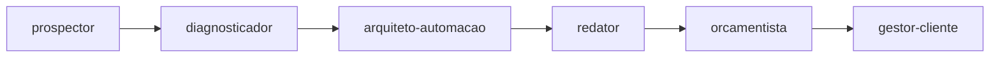
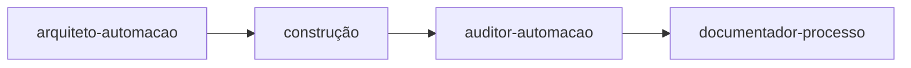

# Agentes para Claude Code

Subagentes em Markdown com frontmatter YAML, no formato do Claude Code.

| Agente | Função | Modelo |
|---|---|---|
| `prospector` | Encontra e qualifica PMEs e escreve a abordagem | Sonnet |
| `diagnosticador` | Mapeia dores por etapa de funil → entregável → impacto | Sonnet |
| `arquiteto-automacao` | Desenha fluxos n8n, chatbot e integrações | Opus |
| `redator` | Copy de landing page, roteiros de chatbot e follow-ups | Sonnet |
| `orcamentista` | Monta a oferta com setup + mensalidade e unit economics | Sonnet |
| `gestor-cliente` | Onboarding, documentação de entrega e relatório de resultado | Sonnet |
| `auditor-automacao` | Revisa riscos de um workflow antes de ir para produção (só leitura) | Opus |
| `documentador-processo` | Transforma um processo num guia para a equipe e a liderança | Sonnet |

O ciclo comercial roda nesta ordem:

E o ciclo técnico de cada automação:

## Como usar

1. Copie os arquivos `.md` (menos este README) para `.claude/agents/` na raiz do seu projeto.
2. Copie o `CLAUDE.md` para a raiz do projeto.
3. Abra o Claude Code na pasta e descreva a missão; ele aciona os agentes na ordem.
