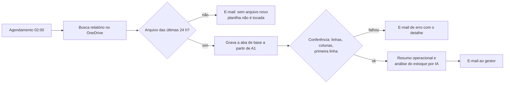

# Atualização diária de relatório

Workflow **n8n** agendado (com versão alternativa em Power Automate + Office
Scripts) que atualiza toda madrugada a base de uma planilha mestre de estoque
a partir do relatório do dia, confere a gravação e envia um resumo ao gestor.

## Regras do workflow
- Só nós nativos do n8n Cloud.
- Atualiza apenas a aba de base; dashboards e outras abas ficam intactos.
- Conferência determinística antes da IA: a IA só escreve o resumo.
- Três avisos: sucesso, sem arquivo novo e erro.
- Entregue salvo e desligado; ativado só depois de revisão.
- Se faltar credencial, ID ou nome de aba, o construtor para e pergunta.
