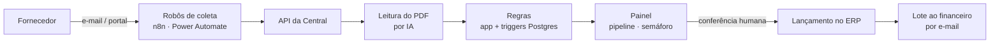

# Central de Contas a Pagar

> Projeto interno desenvolvido para uma empresa de varejo. Código e dados são
> privados; este documento descreve só a arquitetura e as regras.

## Problema
O contas a pagar era controlado por planilha e e-mail. Não havia como saber,
em um só lugar, quais cobranças do mês já tinham chegado, quais estavam com
problema e quais já tinham sido lançadas no ERP.

## Solução
Um sistema que acompanha cada cobrança do recebimento do boleto ao lançamento,
com robôs na entrada, leitura de PDF por IA, regras de conferência e um painel
que mostra onde cada uma está.

## Duas dimensões por cobrança
- **Etapa**: aguardando boleto → recebido → em conferência → lançado no ERP →
  enviado ao financeiro → concluído. Cada mudança é registrada com data e hora.
- **Saúde**: OK, atenção ou erro, sempre com o motivo.

## Regras automáticas
1. Valor da nota diferente do boleto → atenção.
2. Linha digitável duplicada → erro (também travada por índice único no banco).
3. Boleto sem nota → atenção.
4. Vencimento em até 10 dias sem boleto → erro.
5. Boleto e nota batendo → avança para conferência.
6. CNPJ do pagador diferente da loja → erro.
7. Beneficiário de outra empresa (raiz do CNPJ) → erro.

As regras rodam no aplicativo **e** em triggers do banco, para valerem também
quando um robô grava direto no banco.

## Janela de cobrança (D−10)
O mês é dividido em três blocos de vencimento, e cada um tem sua janela de
cobrança 10 dias antes. As datas saem de cálculo de calendário, sem valores
fixos, e o painel destaca o bloco que precisa ser cobrado no dia.

## Engenharia
- Next.js 15, React 19, TypeScript, Tailwind CSS, Supabase (Postgres + Storage).
- Row Level Security em todas as tabelas; escrita só no servidor.
- Arquivos em bucket privado servidos por URL assinada.
- Modo demonstração que sobe sem nenhuma variável de ambiente, com dados fictícios.
- Testes automatizados e deploy contínuo via GitHub Actions.
