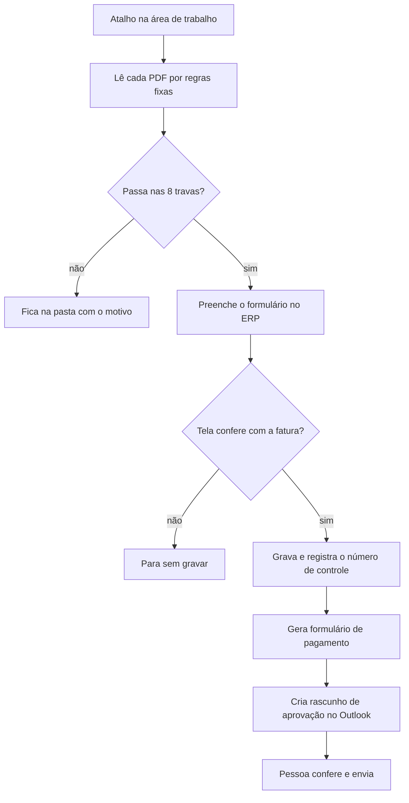

# Lançador automático no ERP

> Projeto interno. Código e dados são privados; este documento descreve só o
> funcionamento.

Programa em **PowerShell, sem IA**, que lança boletos no ERP operando a tela
do sistema como uma pessoa faria. Trabalha junto com a
[Central de Contas a Pagar](central-contas-a-pagar.md): a Central recebe e
organiza; o Lançador grava no ERP.

## As 8 travas
1. Já lançado (mesmo fornecedor e número, ou mesma loja com mesmo valor e vencimento).
2. Só boleto: débito automático, nota de débito ou nota sozinha não entram.
3. Fornecedor sem contrato cadastrado para a loja.
4. Primeira vez do fornecedor na loja, sem histórico para comparar.
5. Código de despesa diferente do histórico.
6. Valor muito diferente do contrato ou vencimento já passado.
7. CNPJ ausente ou que não confere.
8. Duas cópias do mesmo boleto na pasta.

## Resultado de cada rodada
- **Verde**: lançado, com número de controle e rascunho.
- **Amarelo**: ficou na pasta, com o motivo.
- **Vermelho**: parou; daqui para a frente nada foi feito.

## Segurança e operação
- Relê a tela antes de gravar; se algo não bate, para sem gravar.
- Nunca envia e-mail sozinho: cria o rascunho e a pessoa envia.
- Arquivos comparados byte a byte antes de sair da pasta; nada é apagado.
- Toda mudança de regra é testada contra o histórico de formulários antes de
  entrar em uso.
- A versão anterior fica guardada para voltar em minutos.
- Atalhos complementares: encaminhar aprovações ao financeiro (sem duplicar) e
  auditar, só lendo, os lançamentos dos últimos 7 dias.

## Resultado
Cerca de 1,5 minuto por lançamento, do PDF ao rascunho do e-mail, contra o
preenchimento manual de todos os campos.
